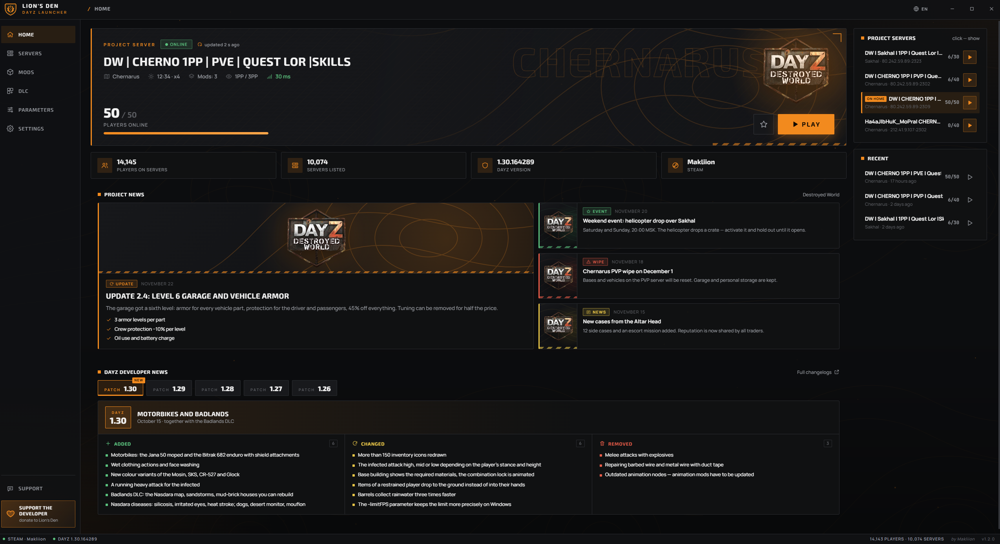
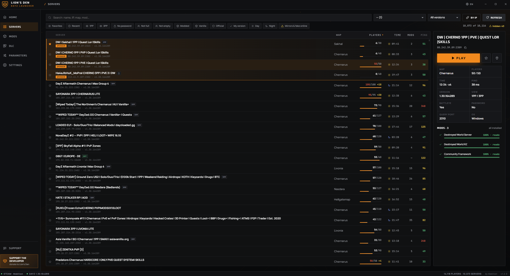
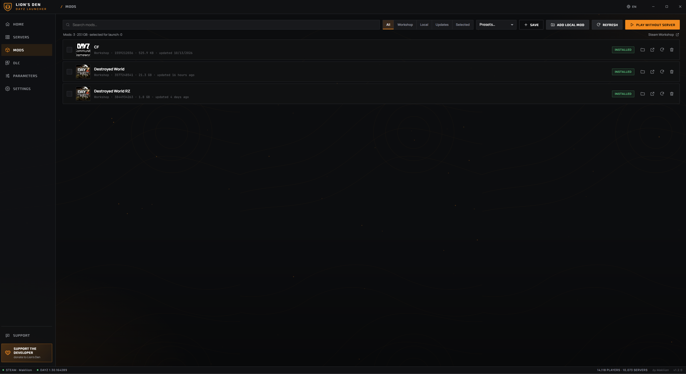
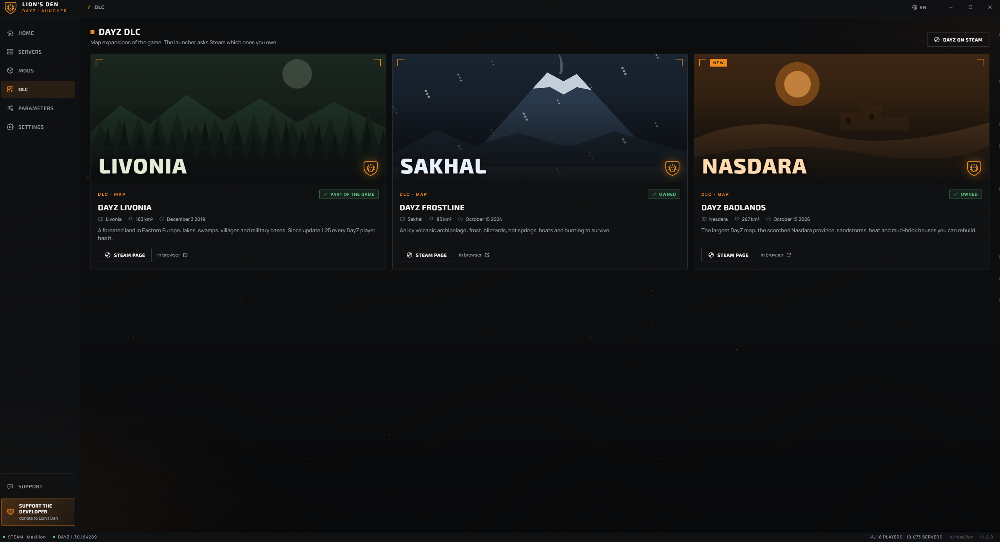
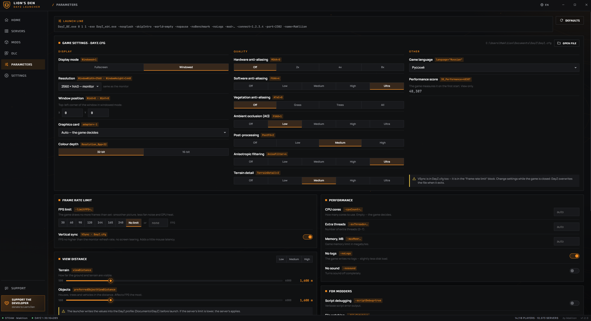
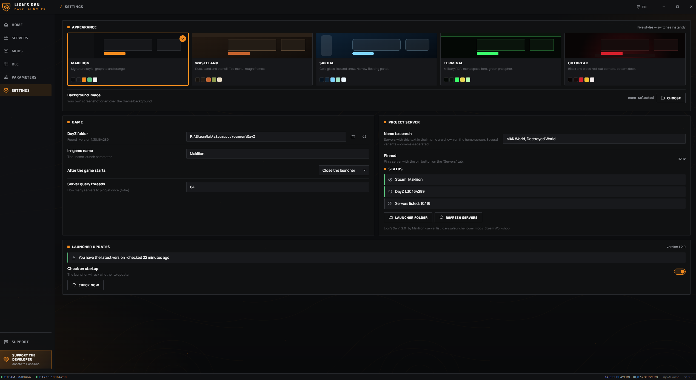

## Lion's Den 1.2.0 — DayZ launcher by Makliion

**Free DayZ launcher for Windows** — server browser with live ping, one-click join, automatic Steam Workshop mod install, mod presets, BattlEye.  
**Бесплатный лаунчер DayZ** для Windows — список серверов, вход в один клик, автоустановка модов из Steam Workshop, пресеты модов, BattlEye.

**[⬇ Download / Скачать — LionsDen_Setup_1.2.0.exe](https://github.com/Makliion/Lions-Den/releases/latest)**

## Lion's Den — DayZ launcher

### Features
- **Server browser** — search by name, IP, map and mods, filters, sorting, favorites, recent servers.
- **Live ping and player count**, server details with map, time, version, BattlEye and mod list.
- **Clean list** — mirrors and servers with fake online are hidden (a separate filter shows them).
- **One-click join** — checks game version and password, subscribes to missing Steam Workshop mods, starts the game with BattlEye.
- **Download progress in %** for every mod in server details.
- **Right-click a server** — join right away, or start the game with the server's mods and stay in the main menu.
- **Mods** — subscribed Workshop mods and local mods, update, unsubscribe, presets, play without a server; right-click a mod in server details to check for and install updates.
- **Add a local mod** from any folder, like in the official launcher.
- **Home screen** — click a project server in the right column to show it in the big card; player count, time and ping refresh every 15 seconds.
- **Project news** with the Destroyed World logo.
- **DayZ developer news** — what was added, changed and removed in patches 1.26–1.30, with a tab for each patch.
- **Game settings from DayZ.cfg** — display, quality and other settings right in the launcher; a backup of DayZ.cfg is made before the first change.
- **FPS limit and vertical sync**.
- **View distance** and object view distance.
- **Clear game logs** — deletes .log, .rpt and .mdmp files from `%LOCALAPPDATA%\DayZ` in one click.
- **Launch parameters** from the official launcher plus your own arguments.
- **DLC tab** — DayZ Livonia, DayZ Frostline and DayZ Badlands: map info, whether you own them, and Steam links.
- **Support** — write to the launcher developer right from the app.
- **Support the developer** — a donation button for Lion's Den.
- **5 visual styles** and a custom background.
- **12 languages**, starts in your Windows language.
- **Updates** — the launcher finds new versions and asks: update now, later, or skip.

### Install
Download `LionsDen_Setup_1.2.0.exe` and run it. No admin rights needed. Requires Steam and DayZ.

---

## Lion's Den — лаунчер DayZ

### Что умеет
- **Список серверов** — поиск по имени, IP, карте и модам, фильтры (1PP/3PP, без пароля, с модами и без, день/ночь, своя версия игры), сортировка, избранное, недавние.
- **Живой пинг и онлайн** — сервера опрашиваются напрямую, в карточке сервера: карта, время, версия, BattlEye, список модов.
- **Чистый список** — зеркала (один сервер под многими адресами) и сервера с накруткой онлайна скрыты, их можно показать отдельным фильтром.
- **Вход в один клик** — лаунчер проверяет версию игры и пароль, сам подписывается на недостающие моды в Steam Workshop и запускает игру с BattlEye.
- **Прогресс загрузки в %** у каждого мода в карточке сервера.
- **Правая кнопка по серверу** — подключиться сразу или запустить игру с модами сервера и остаться в главном меню.
- **Моды** — подписанные моды из Workshop и локальные моды, обновление, отписка, пресеты, игра без сервера. Правой кнопкой по моду в карточке сервера — проверка и установка обновления.
- **Добавление локального мода** из любой папки, как в официальном лаунчере.
- **Главная** — клик по серверу проекта в правой колонке показывает его в большой карточке; онлайн, время и пинг обновляются каждые 15 секунд.
- **Новости проекта** с логотипом Destroyed World.
- **Новости разработчиков DayZ** — что добавлено, изменено и убрано в патчах 1.26–1.30, отдельная вкладка на каждый патч.
- **Настройки игры из DayZ.cfg** — экран, качество и прочее прямо в лаунчере; перед первым изменением делается резервная копия DayZ.cfg.
- **Лимит FPS и вертикальная синхронизация**.
- **Дальность прорисовки** и дальность прорисовки объектов.
- **Очистка логов игры** — удаляет файлы .log, .rpt и .mdmp из `%LOCALAPPDATA%\DayZ` в один клик.
- **Параметры запуска** как в официальном лаунчере плюс свои аргументы.
- **Вкладка «Дополнения»** — DayZ Livonia, DayZ Frostline и DayZ Badlands: описание карт, куплено ли дополнение, ссылки на Steam.
- **Поддержка** — написать разработчику лаунчера прямо из окна.
- **Поддержать разработчика** — кнопка доната на Lion's Den.
- **5 стилей оформления** и свой фон.
- **12 языков** — лаунчер сразу открывается на языке Windows, язык меняется кнопкой в заголовке окна.
- **Обновления** — лаунчер сам находит новую версию и спрашивает: обновить сейчас, позже или пропустить.

### Установка
Скачайте `LionsDen_Setup_1.2.0.exe` и запустите. Права администратора не нужны: лаунчер ставится в профиль Windows, ярлыки появятся на рабочем столе и в «Пуске». Удаление — через «Приложения» Windows.

Нужны Steam и установленная DayZ.

_by Makliion_
